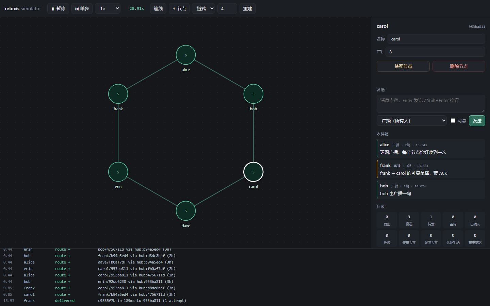

# Retexis

> 拉丁 *rete*（网）+ *texere*（编织）—— **编织成网**。
> crate 前缀 `retexis-`，二进制 `retexis`，线格式 magic `RX`。

一个分层的 mesh 传输器：**硬件解耦 / 路由 / 传输** 三层各自独立，任一层的实现都可以整体替换。

目前 `tcp://` 是唯一编译进来的介质，`chat` 是唯一编译进来的应用协议 —— 但两者都只是"第一个实现"，
不是架构的假设。依赖极少且**全部是纯 Rust**：只有 RustCrypto 的 `sha2` + `hmac`
（连同传递依赖共 10 个 crate），没有 C 工具链、没有 `cc`/`bindgen`、不用 `ring`/`aws-lc-rs`。
线格式、路由、限流、重传仍然全部自己实现——那些是产品本身，没有现成的可复用。

```
alice <--tcp--> bob <--tcp--> carol      alice 和 carol 之间没有连接
                                         但 carol 能直接 /msg alice
```

已实现的能力：

| 能力 | 做法 |
|---|---|
| **硬件解耦** | `Link` trait 拥有分帧权，路由层只交出字节；`tcp://` 只是注册表里的一个 scheme |
| **路由** | 距离矢量 + 水平分割 + 去重 + TTL，多跳单播、广播泛洪 |
| **认证** | 预共享密钥，每个包带截断 HMAC-SHA256；解析前过滤，坏包进不了解码器 |
| **重连** | 每条 `--connect` 一个监督线程，指数退避 + 抖动，链路死了自动重拨 |
| **重传** | 端到端 ACK + 指数退避重传；中继会把重传当重传转发，不会当重复包吃掉 |
| **泛洪抑制** | 令牌桶（全局 + 按来源），默认预算在聊天负载下永不触发 |
| **模拟器** | `retexis-sim`：每个节点就是一个真 Router 线程，一台虚拟交换机按网页配置插拔链路 |
| **可视化编辑器** | 浏览器里拖节点、连链路、改延迟丢包、按节点收发消息，看真实路由表收敛 |
| **参考模型** | `sim/`：Python 第二实现，9 个场景秒级跑完，与 Rust 字节级互通 |

---

## 快速开始

```bash
cargo build --release

# 终端 1：监听，不做任何 outbound 连接
./target/release/retexis --name alice --listen tcp://0.0.0.0:7100 --psk "our secret"

# 终端 2：连上 alice，同时自己监听 7101
./target/release/retexis --name bob --connect tcp://127.0.0.1:7100 \
    --listen tcp://0.0.0.0:7101 --psk "our secret"

# 终端 3：只连 bob，和 alice 之间没有任何直连
./target/release/retexis --name carol --connect tcp://127.0.0.1:7101 --psk "our secret"
```

然后在 carol 里：

```
hello mesh                                    # 广播，两跳后到达 alice
/msg alice 这条是单播，bob 帮我转发的          # 可靠单播：有 ACK、会重传
/routes                                       # 路由表：谁、几跳、下一跳是谁、多久没刷新
/peers                                        # 物理链路：介质、方向、对端身份
/status                                       # 计数器：转发/泛洪/去重/重传/认证拒绝
/kick bob                                     # 踢掉链路，看监督线程把它接回来
```

去掉 `--psk` 就是明文模式（开发用）。带 `--psk` 时，密钥不对的节点连握手都过不去。

两个一键演示：

```bash
./scripts/demo.sh        # 三节点链式拓扑：多跳广播 + 单播
./scripts/demo-auth.sh   # 认证 + 踢链路 + 自动重连（含一个错误密钥的入侵者）
```

`demo-auth.sh` 的真实输出节选 —— bob 的视角：

```
  · > route +    alice/699b3748 via 127.0.0.1:7200 (1 hop)
  · ! auth       rejected 127.0.0.1:22021 (bad tag)      ← mallory 一直撞墙
  · > route -    alice/699b3748 (link down)              ← /kick alice
  · ~ retry      tcp://127.0.0.1:7200 in 299ms (attempt 1)
  · ~ connected  tcp://127.0.0.1:7200
  · > route +    alice/699b3748 via 127.0.0.1:7200 (1 hop)
```

carol 的可靠单播：

```
me → alice             this DM is acked and retransmitted
  · v delivered  945a57b8 in 0ms to 699b3748 (1 attempt)
reliable  acked 1   failed 0   retransmits 0
```

---

## 分层

```
┌──────────────────────────────────────────────────────────────────────┐
│ retexis-app       传输层    "这些字节是什么意思"                     │
│   Transport trait · 按 channel 分发 · ChatTransport(文本)             │
│   之后: 文件/二进制通道 · 流式通道(StreamChunk 已在信封里预留)         │
├──────────────────────────────────────────────────────────────────────┤
│ retexis-routing   路由层    "这些字节该去哪 / 能不能信任"            │
│   NodeId · 距离矢量路由表 · 单播/泛洪 · 去重 · TTL · 认证过滤         │
│   ACK + 重传 · 泛洪限流 · 重连拨号器 · MeshHandle                     │
├──────────────────────────────────────────────────────────────────────┤
│ retexis-core      契约层    "线上一个字节是什么"                     │
│   Envelope 线格式(固定 64B 头) · Link/LinkAcceptor/LinkFactory trait   │
│   TransportRegistry: 按 URL scheme 找介质                             │
├──────────────────────────────────────────────────────────────────────┤
│ retexis-link-tcp  介质层    "字节怎么动"                             │
│   长度前缀分帧 · 读写分离 · 之后: http / ws / radio                   │
└──────────────────────────────────────────────────────────────────────┘
         retexis-crypto：Sealer 封装 HMAC-SHA256（RustCrypto 纯 Rust 实现）
```

关键约定：

- **路由层永远不解析 payload**，传输层永远不看路由头。
- **介质层拥有分帧权**。路由层只交给它一段已编码的信封字节，怎么放上介质由它决定
  （流式介质加长度前缀，数据报介质一包一帧，窄带介质自己切块）。这就是解耦点。
- **认证是字节流上的过滤器**，在 `Envelope::decode` 之前跑，坏包根本进不了解码器。
- 每层都能单独测试：55 个 Rust 测试 + 9 个模拟场景，其中包含真实 TCP 的多跳/环网/断链、
  确定性丢包链路、四链路并发重连。

## crate 地图

| crate | 职责 | 依赖 |
|---|---|---|
| `retexis-core` | 线格式、ID、`Link` 抽象、介质注册表 | 无 |
| `retexis-crypto` | 信封密封（RustCrypto `sha2` + `hmac`） | 纯 Rust，无 C |
| `retexis-link-tcp` | TCP 介质 | core |
| `retexis-routing` | 路由表、转发、去重、限流、重传、拨号器 | core, crypto |
| `retexis-app` | `Transport` trait、chat 通道、终端输出 | core, routing |
| `retexis-node` | 二进制 `retexis`：参数解析 + REPL | 全部 |
| `retexis-sim` | 模拟器：虚拟交换机 + JSON API + 单页 UI | core, routing, app |

## 线格式（v2）

固定 64 字节头，手工编码（不用 serde），好处是稳定、可跨语言解码、窄带介质能只看头就判断
装不装得下：

```
offset  size  field
     0     2  magic "RX"
     2     1  version (2)
     3     1  flags        0x01 已认证(尾部带 tag)  0x02 请求 ACK
     4     1  ttl          剩余跳数
     5     1  hops         已走跳数
     6     1  dst_kind     0=广播 1=单播
     7     1  body_kind    0=data 1=hello 2=route 3=bye 4=ack
     8    16  message id    用于去重
    24    16  source node id
    40    16  destination node id
    56     8  created_at    unix ms
    64     -  body
     -    16  auth tag（仅当 flags & 0x01，HMAC-SHA256 截断）
```

五种 body：

- `data`：`channel` + `content_type` + 字节。路由层把它当不透明字节。
- `hello`：链路本地握手，"我是谁 + 我这条链路的 id"。带对端链路 id 是为了让两端算出
  同一个排序键，重复链路才能收敛到同一条。
- `route`：距离矢量通告，每条目 `(节点 id, 距离, 名字)`。只发一跳。
- `ack`：端到端回执，携带被确认的 message id。会被路由，不交给应用。
- `bye`：优雅断开。

`content_type` 已经预留了 `Binary` / `StreamOpen` / `StreamChunk` / `StreamClose`，
所以将来加二进制和流式传输 **不需要改线格式**。

## 路由协议

距离矢量（Bellman-Ford），没有任何中心节点：

1. **握手**：链路建立后双方立刻互发 `hello`，把 `LinkId` 绑定到对端 `NodeId`。
   Hello 是请求-应答：即使已经认识对方也要回一个，否则单次丢包会让链路永远半识别
   （TCP 上内核会重传所以看不见，换成 radio 就是致命问题）。
2. **通告**：收到 hello 后立即把自己的整张路由表发给对端，之后每个 `announce_interval`
   再发一次。新链路一轮就能收敛。
3. **学习**：条目 `(dst, d)` 表示"我到 dst 是 d 跳"，我这边候选距离是 `d+1`，
   比现有更小才替换下一跳。名字跟着路由一起传播，所以两跳之外也有名字。
4. **转发**：先查表。有路由就交给下一跳；查不到就泛洪（相当于路由请求）。
5. **环路控制**：
   - 水平分割：从哪条链路学到的路由，不再从那一条发回去。
   - 去重：每个节点记住处理过的 `message id`（TTL 内）。**广播的重复包只处理一次；
     单播的重复包意味着发送方没收到 ACK，中继要再转发一次**——否则一次短暂断链就能让
     重传永远无效。
   - TTL：跳数预算，兜住一切。
6. **失效**：链路断开 → 立即删掉所有经由该链路的路由；路由超过 `route_timeout`
   没被刷新 → 过期删除。

## 认证

预共享密钥 → `sha256(passphrase)` 作为 HMAC key，每个信封尾部附 16 字节截断 tag，
覆盖头部和 body 的每一个字节（包括 `src`，所以包在途中不能被改地址）。

四个象限的策略是显式的，不存在"降级"：

| 本节点有密钥 | 包带 tag | 结果 |
|---|---|---|
| 有 | 有 | 验签，失败即丢弃 |
| 有 | 无 | 丢弃（明文包不得进入已认证的 mesh） |
| 无 | 有 | 丢弃（无法验证，不猜） |
| 无 | 无 | 放行（明文模式） |

tag 比较走 RustCrypto 的 `verify_truncated_left`（内部 `subtle::ct_eq`，常数时间），
避免逐字节时序侧信道。这是**入网认证**（谁可以加入这个 mesh），
不是节点身份认证：同一个 mesh 内的成员理论上可以伪造彼此的 `src`。真正的身份绑定需要
每节点密钥对 + 签名，在路线图里。

## 重传

`/msg` 走可靠单播，广播不走（给广播要 ACK 会把 1 个包变成 N 个）：

```
发送方                       中继                      目的节点
  |-- data(ACK_REQ) --------->|-- data(ACK_REQ) -------->|
  |                           |                          deliver + 记 dedup
  |<--------------------------|<------------------------- ack(msg id)
  |  超时没等到 ACK？重传同一个 msg id
  |-- data(ACK_REQ) --------->|  已经见过这个 id         |
  |                           |  但这是重传，继续转发 -->|  见过 id：不再投递给应用，
  |                           |                          |  但重新回一个 ACK
```

关键点：**重传复用同一个 message id**。目的节点靠它避免重复投递，中继靠它判断
"这是重传而不是新消息"（见上面去重那段）。ACK 丢失不需要单独机制——发送方重传，
接收方重发 ACK，天然幂等。

重传次数用尽会上报 `RouterNotice::DeliveryFailed`，REPL 打印 `x failed ... (no ack)`。

## 重连

每个 `--connect` 目标一个监督线程：拨号 → 每 200ms 探活 → 断了就按
`base * 2^n`（±25% 抖动，上限 15s）重拨，永不放弃。抖动是为了避免 200 个节点同时
重拨一个刚恢复的中继，把它再打死一次。

两个节点同时拨对方时会出现两条链路。收敛规则必须两端一致，否则会互相关掉对方的幸存者、
无限重拨。做法是让 `hello` 携带发送方这条链路的本地 id：两端都知道同一条物理链路的
两个 id，于是 `(min, max)` 是一个两端都能算出的排序键，保留最小的那条。

## 泛洪抑制

去重保证一条消息每个节点只处理一次，但**不能限制一个节点每秒转发多少条不同消息**。
密集 mesh 里一条广播要被所有节点各转一次，成本是 O(E)，总工作量随消息速率和边数的乘积增长。

所以加了两层令牌桶：全局（默认 200/s，突发 100）和按来源（40/s，突发 30）。
只作用于**中继**，自己发的广播永不限流（用户打字不是风暴）。

默认预算是刻意宽松的：4×3 网格里 96 条广播完全不触发抑制。真正的取舍在过载时才出现——
模拟器量过：480 条广播的过载下，收紧到 30/s 能把转发量从 11584 帧压到 4824 帧（-58%），
代价是送达率从 100% 降到 62.8%。广播本来就是 best effort，这个交换是合理的，而且默认配置
永远不会走到这一步。

---

## 模拟器（Rust）

先把话说清楚：之前那套 Python 模拟器**没有调用 Rust 代码**——它是一份独立的第二实现，
靠跨语言向量和 Rust 对齐。真正驱动生产代码的模拟器是 `retexis-sim`：

```bash
cargo run -p retexis-sim                              # line x4 → http://127.0.0.1:8770
cargo run -p retexis-sim -- --preset grid --nodes 9   # 9 节点网格
cargo run -p retexis-sim -- --port 9000 --open
```

每个节点是一个 `retexis_routing::start()` 起的**真 Router**，跑在自己的线程上。握手、距离
矢量、去重、TTL、ack/重传、泛洪限流、HMAC 认证，全走生产路径。模拟器只加两样东西：

1. **介质**——`Hub` 是一台虚拟交换机，按网页配置在节点之间插拔网线；
2. **展示状态**——坐标、收件箱、事件日志。这些不是协议，所以永远不进 Router。

`HubLink` 只实现 `Link` 一个 trait：`send` 把字节交给交换机，`recv` 阻塞等队列。Router 分不出
它和 TCP socket 的区别——这正是硬件解耦层当初要证明的事。加一种新介质不用动模拟器，反过来
模拟器也不用动 Router。

### 交换机怎么模拟一条链路

| 旋钮 | 怎么做的 |
|---|---|
| 延迟 | 每帧排进按到期时间排序的堆，独立线程投递。不是轮询，5ms 的链路真的 ~5ms（有测试量它） |
| 丢包 | 按概率静默丢弃。丢包不是错误，是介质行为，协议自己扛 |
| 切断 | 丢掉两端队列的发送端 → 阻塞中的 `recv` 立刻返回 `Closed` → Router 走真正的 `LinkDown` |
| 杀死节点 | Router 真的 `shutdown()`（会发 `Bye`），链路拔掉，路由表清空 |
| 自动重连 | `supervise` 打开的链路由交换机按 200ms 起、翻倍、封顶 3s 的退避重插 |

"切断"值得强调：不是标记一个 `up=false` 让界面画条断线，而是让两端的 `recv` **真的失败**。
所以你在界面上看到的删路由、单播重传失败，都是协议自己在处理真实的链路错误。

### 暂停、单步、变速

Rust 版跑真实时间，三个旋钮的语义和离散事件版不同，说清楚：

- **暂停**：交换机停止投递，帧堆在队列里（`pending` 计数可见）
- **单步**：恢复 N 秒后自动暂停
- **变速**：只缩放**介质延迟**（`latency / rate`）。400ms 的路由通告是 Router 里的真实定时器，
  模拟器不碰它——它没有权力改协议的节奏

恢复时飞行中的帧不会一次炸出来：每个到期时间整体平移暂停时长。

---

## 可视化编辑器

同一个 UI，两个后端。Rust 版提供同一套 JSON API，所以 `sim/web/index.html` 一个字没改。



能做的事：

- **拖节点**改位置；**连线**模式下点两个节点建立链路
- 点链路：拖延迟/丢包滑块（立刻生效）、切断、愈合、开关「断线自动重连」
- 点节点：改名/改 TTL、杀死/恢复、发广播或可靠单播，实时看它的**收件箱、路由表、计数器**
- 顶栏：运行/暂停/单步、0.25×~5× 变速、链式/环状/网格/星形一键重建
- 底部事件流：链路起落、路由增删、去重丢弃、`v delivered ... 12ms (1 attempt)`

UI 能做的每件事都是一次 API 调用：

| 接口 | 作用 |
|---|---|
| `GET /api/state?log_since=N` | 全量快照 + 增量事件流 |
| `POST /api/control` | 运行/暂停/单步/变速 |
| `POST /api/preset` | 重建拓扑（line/ring/grid/star） |
| `POST /api/node` · `PATCH/DELETE /api/node/{id}` | 增删改节点、改位置、杀死/恢复 |
| `POST /api/link` · `PATCH/DELETE /api/link/{key}` | 增删链路、改延迟丢包、切断/愈合、开关重连 |
| `POST /api/send` | 从某个节点发广播或可靠单播 |

因为 UI 很薄，测试就落在 API 上。`crates/retexis-sim/tests/api.rs` 开真 socket、发 UI 会发的
请求、断言 JSON 形状；`tests/mesh.rs` 直接驱动真实 Router。两套都在 `cargo test` 里。

### 这一版抓到的 bug

链路"愈合"在 `admin_up` 已经是 true 时被当成无操作跳过——而节点重启后链路正好是
`admin_up=true, up=false`，于是按"愈合"什么都不会发生。修法：`up` 字段永远执行，不去和
意图比较（`set_up` 本身幂等）。这是"Rust 版不是复刻，而是另一条代码路径"的直接证据。

---

## Python 参考模型

`sim/` 留下来不是历史包袱，它回答的是另一个问题：**换一种实现还能不能互通**。

| | `retexis-sim`（Rust） | `sim/`（Python） |
|---|---|---|
| 协议代码 | 生产代码本身 | 独立重写的一份 |
| 时间 | 真实时间，真线程 | 离散事件，可任意快进 |
| 强项 | 交互式调试、看真实路由表 | 批量场景断言、跨语言向量 |
| 协议改了 | 自动跟上 | 要手工同步 |

真正有意思的统计问题——5×5 网格多久收敛、一次风暴要多少帧、丢 30% 包会怎样——离散事件
模型比真 socket 快几个数量级，所以场景跑在这里：

```bash
python sim/run.py --list        # 看有哪些场景
python sim/run.py all           # 跑全部，失败则退出码非 0
python sim/run.py storm --json  # 单个场景，机器可读
python sim/run.py loss --verbose # 打印完整事件日志
```

九个场景：

| 场景 | 断言什么 |
|---|---|
| `line` | 4 节点链式，广播/单播穿过 3 跳，hop 计数正确 |
| `triangle` | 环网一次广播每节点**恰好**收到一次（去重生效，无风暴） |
| `ttl` | ttl=1 只到邻居，两跳外收不到 |
| `loss` | 40% 丢包下可靠单播 8/8 送达、无重复投递、best effort 会丢 |
| `auth` | 错误密钥的节点拿不到任何路由、收不到任何流量 |
| `reconnect` | 杀掉节点 → 路由过期 → 退避重拨 → 复活后重新收敛 |
| `partition` | 切断中段 → 双方遗忘 → 愈合 → 重新收敛 |
| `relay` | 中继的下一条跳短暂断链后，重传仍能穿过 |
| `storm` | 默认预算在正常负载下不触发；过载时转发量降 58%，送达率 62.8% |

它仍然和 Rust **字节级互通**：`sim/golden.py` 生成向量文件，`cargo test` 里的
`python_compat` 用它重建每个信封、编码、逐字节比对，再解码回读。两边一旦漂移立刻红。

```bash
python sim/golden.py --write   # 重新生成 crates/retexis-core/tests/golden_vectors.txt
```

### 这份参考模型抓到的真实 bug

写第二份实现的回报很直接——下面两个都是它先发现，不是读代码想出来的：

1. **单次 Hello 丢失 → 链路永久半识别**。`a` 不知道 `b` 是谁，于是既不发路由也不泛洪，
   链路静默失效。修复：Hello 变成请求-应答，且未识别的链路每个通告周期重发一次。
2. **中继把重传当重复包吃掉**。carol 经 bob 发给 alice 的 DM，恰逢 bob 到 alice 的链路
   抖动，bob 缓存了 msg id 然后丢弃所有重传，消息永远到不了。修复：去重只抑制广播，
   单播重复包在中继处继续转发。

两个都补了回归测试，并且验证过"移除修复 → 测试变红"。

## 测试

```bash
cargo test --workspace                   # 95 个测试
python sim/run.py all                    # 9 个场景
python -m unittest sim/test_server.py     # 14 个 API 测试
cargo clippy --workspace --all-targets
```

Rust 侧覆盖的真实场景：

- `crates/retexis-crypto`：FIPS/RFC 4231 向量、截断 tag 校验、密钥不泄漏
- `crates/retexis-core`：编解码往返、截断拒绝、名字 UTF-8 截断、与 Python 的字节级互通
- `crates/retexis-link-tcp`：粘包/半包、超大帧、`shutdown` 唤醒阻塞的 `recv`
- `crates/retexis-routing`：
  - 链式两跳（广播 + 单播，hop 计数）、三角环网去重、TTL=1、断链失效
  - **认证**：同密钥收敛、错密钥零路由、明文节点被拒
  - **重传**：确定性丢包链路上 8 条消息全部送达且只投递一次、丢 ACK 靠重应答恢复、
    发不出去时报 `DeliveryFailed`
  - **中继重传**：切掉最后一跳再愈合，重传仍能穿过
  - **重连**：`/kick` 式断链后监督线程重拨；四链路并发拨号收敛到一条且不振荡
  - **限流**：中继被限流、自己发的消息照常送达
- `crates/retexis-sim`：
  - 真 Router 过虚拟交换机：链式/环网收敛、广播恰好一次、两跳单播被 ack
  - 切断删路由、愈合恢复、150ms 延迟真的 ≥120ms、50% 丢包触发重传且不重复投递
  - 杀死节点后路由表为空、受监督链路自动重插、未受监督的保持断开
  - 暂停时帧留在队列、恢复后送达；日志游标只返回新增条目
  - API 层：10 个测试用真 socket 发 UI 会发的请求，含坏 JSON / 坏 id / 未知路径

## 已知限制（刻意留白的部分）

- **入网认证 ≠ 身份认证**。共享密钥意味着成员之间可以互相冒充。要真身份得每节点密钥对。
- **没有加密**。tag 只保证完整性和成员资格，内容在线上是明文。
- **窄带介质缺分片**。装不下就丢并上报 notice，不替介质切片重组（那是介质的事）。
- **纯距离矢量有 count-to-infinity 风险**。水平分割 + TTL + 去重把影响限制住了。
- **泛洪抑制是本地决策**，没有 MPR 那样的协作，所以过载时必然牺牲覆盖。
- **一个卡住的 TCP 写会拖住 router 线程**。要上吞吐，第一件事是给链路写侧加有界队列 +
  独立写线程。
- **模拟器不覆盖拨号器和 TCP 分帧**。网线是交换机插的，没有拨号过程，`HubLink` 也不存在
  粘包。这两条由 `retexis-routing` / `retexis-link-tcp` 的集成测试负责。
- **模拟器的 `rate` 只缩放介质延迟**。路由通告的定时器在 Router 里，改不了也不该改。

## 路线图

- 介质：`http://`（长轮询）、`ws://`、`radio://`（LoRa/串口，窄带分片）
- 传输：二进制通道、流式通道（`StreamOpen/Chunk/Close` 已在线格式里）、大消息分片
- 路由：按需路由（AODV）、多路径、链路质量度量、MPR 泛洪
- 安全：每节点密钥对 + 信封签名、端到端加密、密钥轮换
- 运维：`--config` 文件、指标导出、异步写队列
- 模拟器：把 `dial::Dialer` 也接进交换机（真拨号而不是插线）、按节点注入 CPU/队列延迟

## License

MIT
