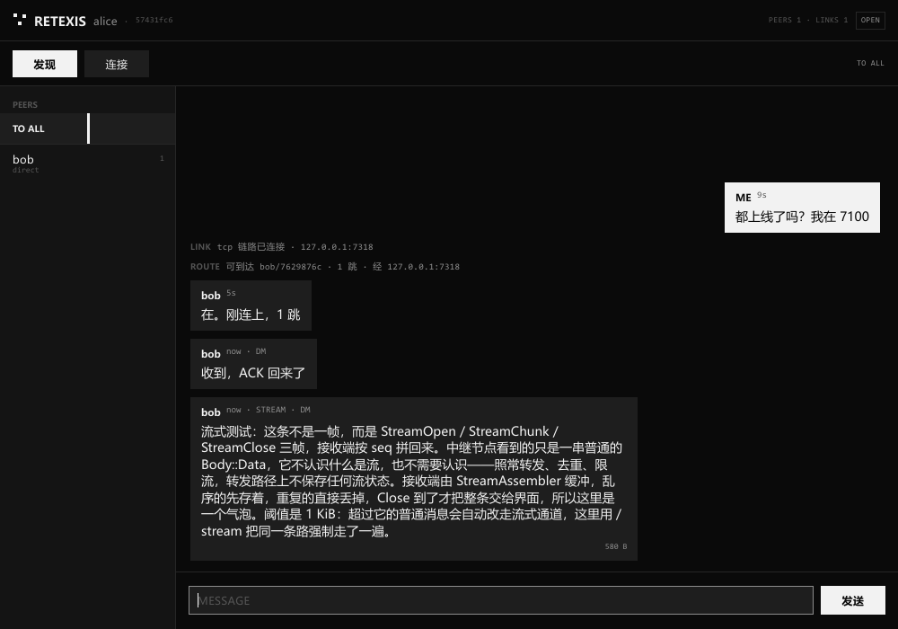
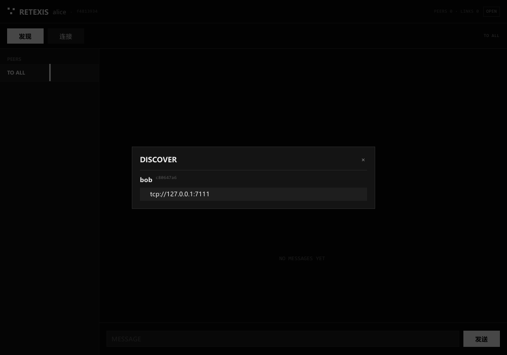
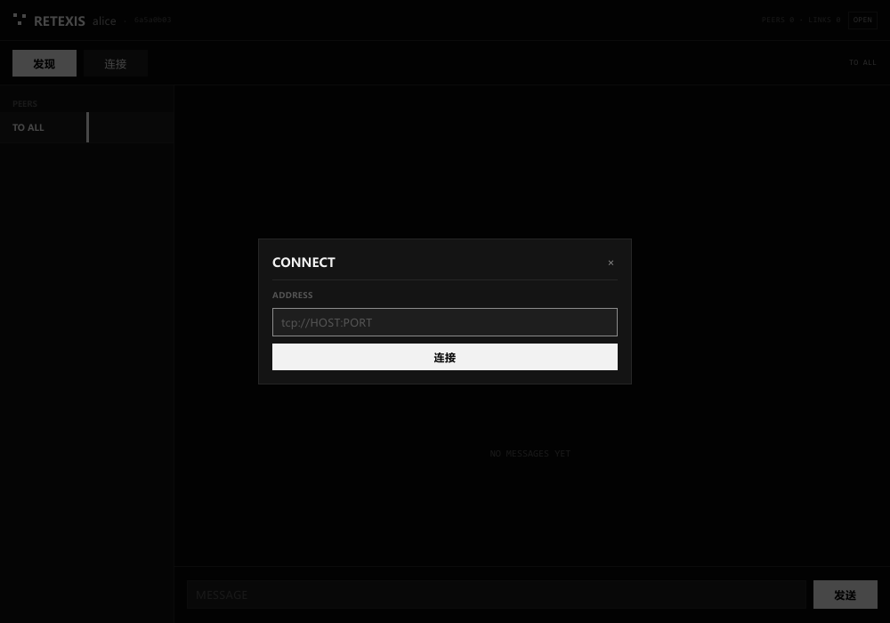

# Retexis

> 拉丁 *rete*（网）+ *texere*（编织）—— **编织成网**。
> crate 前缀 `retexis-`，二进制 `retexis`，线格式 magic `RX`。

一个分层的 mesh 传输器：**硬件解耦 / 路由 / 传输** 三层各自独立，任一层的实现都可以整体替换。

目前 `tcp://` 是唯一编译进来的介质，`chat` 是唯一编译进来的应用协议 —— 但两者都只是"第一个实现"，
不是架构的假设。依赖极少且**全部是纯 Rust**：只有 RustCrypto 的 `sha2` + `hmac`
（连同传递依赖共 10 个 crate），没有 C 工具链、没有 `cc`/`bindgen`、不用 `ring`/`aws-lc-rs`。
线格式、路由、限流、重传仍然全部自己实现——那些是产品本身，没有现成的可复用。

```
alice <--tcp--> bob <--tcp--> carol      alice 和 carol 之间没有连接
                                         但 carol 能直接 /msg alice
```

已实现的能力：

| 能力 | 做法 |
|---|---|
| **硬件解耦** | `Link` trait 拥有分帧权，路由层只交出字节；`tcp://` / `udp://` 只是注册表里的两个 scheme |
| **介质** | TCP（长度前缀分帧）· UDP（一包一帧，无分帧）· 模拟交换机；路由层为加介质改 0 行 |
| **发现** | IP 广播（UDP）问"谁在"，应答里带各自的 `tcp://` / `udp://` 端点；不能广播的介质返回空 |
| **路由** | 距离矢量 + 水平分割 + 去重 + TTL，多跳单播、广播泛洪 |
| **认证** | 预共享密钥，每个包带截断 HMAC-SHA256；解析前过滤，坏包进不了解码器 |
| **重连** | 每条 `--connect` 一个监督线程，指数退避 + 抖动，链路死了自动重拨 |
| **重传** | 端到端 ACK + 指数退避重传；中继会把重传当重传转发，不会当重复包吃掉 |
| **泛洪抑制** | 令牌桶（全局 + 按来源），默认预算在聊天负载下永不触发 |
| **模拟器** | `retexis-sim`：每个节点就是一个真 Router 线程，一台虚拟交换机按网页配置插拔链路 |
| **可视化编辑器** | 浏览器里拖节点、连链路、改延迟丢包、按节点收发消息，看真实路由表收敛 |
| **桌面聊天** | `retexis-gui`：原生窗口（Slint，软件渲染），底下是真 Router + 真 TCP/UDP，不是演示 |

---

## 快速开始

```bash
cargo build --release

# 终端 1：监听，不做任何 outbound 连接
./target/release/retexis --name alice --listen tcp://0.0.0.0:7100 --psk "our secret"

# 终端 2：连上 alice，同时自己监听 7101
./target/release/retexis --name bob --connect tcp://127.0.0.1:7100 \
    --listen tcp://0.0.0.0:7101 --psk "our secret"

# 终端 3：只连 bob，和 alice 之间没有任何直连
./target/release/retexis --name carol --connect tcp://127.0.0.1:7101 --psk "our secret"
```

不想开终端也行——桌面应用是独立二进制，底层是同一个节点：

```bash
cargo run -p retexis-gui                       # 一个原生窗口，自动监听 7100 并广播自己
cargo run -p retexis-gui -- --name bob        # 第二个窗口，点「发现」就能找到第一个
```

不想手打地址时，广播发现一步到位：

```bash
# alice 应答发现请求，把自己两个端点都报出去
./target/release/retexis --name alice --listen tcp://0.0.0.0:7100 \
    --listen udp://0.0.0.0:7101 --announce --psk "our secret"

# bob 不给地址：广播问一句，连上所有应答者
./target/release/retexis --name bob --discover --discover-connect --psk "our secret"
```

然后在 carol 里：

```
hello mesh                                    # 广播，两跳后到达 alice
/msg alice 这条是单播，bob 帮我转发的          # 可靠单播：有 ACK、会重传
/routes                                       # 路由表：谁、几跳、下一跳是谁、多久没刷新
/peers                                        # 物理链路：介质、方向、对端身份
/status                                       # 计数器：转发/泛洪/去重/重传/认证拒绝
/kick bob                                     # 踢掉链路，看监督线程把它接回来
/net                                          # 网络视图：每条链路 + 通过它可达的节点
/stream bob 一段很长的文本                     # 走流式通道（open/chunk/close）
/connect udp://10.0.0.7:7101                  # 运行中连一个新地址
/discover 400                                 # 广播问一句：400ms 内谁应答
```

去掉 `--psk` 就是明文模式（开发用）。带 `--psk` 时，密钥不对的节点连握手都过不去。

### 连接到一个已知地址

三种方式，走的是同一条拨号路径（`Connector`），介质由 URL 的 scheme 决定：

| 场景 | 写法 |
|---|---|
| 启动就连 | `--connect tcp://10.0.0.7:7100`，可重复，可混介质 |
| 运行中连 | REPL `/connect udp://10.0.0.7:7101` |
| 不知道地址 | `--discover --discover-connect`，或 `/discover` 先看一眼 |

```bash
retexis --name bob --connect tcp://10.0.0.7:7100 --connect udp://10.0.0.7:7101
```

- 默认**受监督**：断了按指数退避重拨（250ms 起，翻倍，封顶 15s，±25% 抖动）。
  `--no-reconnect` 只试一次，失败就报 `! dial ...` 并放弃。
- **URL 必须带 scheme**。`--connect 127.0.0.1:7100` 会报
  `no medium for '127.0.0.1:7100' (have: tcp, udp)`——介质是从注册表按 scheme 查的，
  不猜。
- 同一个地址重复给（或发现结果和 `--connect` 撞了）只会拨一次。
- 连上不等于通了：还要看 `/peers` 有没有 `link up`、`/routes` 里有没有对方。
  握手成功但密钥不对，会在 `/status` 里看到 `auth_rejected` 增长。

四个一键演示：

```bash
./scripts/demo.sh            # 三节点链式拓扑：多跳广播 + 单播
./scripts/demo-auth.sh       # 认证 + 踢链路 + 自动重连（含一个错误密钥的入侵者）
./scripts/demo-udp.sh        # 同一套协议跑在 UDP 上
./scripts/demo-discovery.sh  # 一个节点应答发现，另一个不给地址就找到它
```

`demo-auth.sh` 的真实输出节选 —— bob 的视角：

```
  · > route +    alice/699b3748 via 127.0.0.1:7200 (1 hop)
  · ! auth       rejected 127.0.0.1:22021 (bad tag)      ← mallory 一直撞墙
  · > route -    alice/699b3748 (link down)              ← /kick alice
  · ~ retry      tcp://127.0.0.1:7200 in 299ms (attempt 1)
  · ~ connected  tcp://127.0.0.1:7200
  · > route +    alice/699b3748 via 127.0.0.1:7200 (1 hop)
```

carol 的可靠单播：

```
me → alice             this DM is acked and retransmitted
  · v delivered  945a57b8 in 0ms to 699b3748 (1 attempt)
reliable  acked 1   failed 0   retransmits 0
```

---

## 分层

```
┌──────────────────────────────────────────────────────────────────────┐
│ retexis-app       应用层    "人怎么用它"                             │
│   CLI/REPL · 表格与网络树渲染 · chat 应用（一个 DataSink）            │
│ retexis-gui       应用层    同一个 chat 协议，另一个界面             │
│   原生窗口 (Slint/软件渲染) · 时间线 · 发现/连接面板 · 唯一带 GUI 的 crate │
├──────────────────────────────────────────────────────────────────────┤
│ retexis-data      数据层    "这些字节是什么意思"                     │
│   Frame(一帧一条消息) · Stream(open/chunk/close + 重组) · DataHost    │
├──────────────────────────────────────────────────────────────────────┤
│ retexis-routing   路由层    "这些字节该去哪 / 能不能信任"            │
│   NodeId · 距离矢量路由表 · 单播/泛洪 · 去重 · TTL · 认证过滤         │
│   ACK + 重传 · 泛洪限流 · 重连拨号器 · MeshHandle                     │
├──────────────────────────────────────────────────────────────────────┤
│ retexis-core      契约层    "线上一个字节是什么"                     │
│   Envelope 线格式(固定 64B 头) · Link/LinkAcceptor/LinkFactory trait   │
│   TransportRegistry: 按 URL scheme 找介质                             │
├──────────────────────────────────────────────────────────────────────┤
│ retexis-link-tcp  介质层    "字节怎么动"                             │
│   长度前缀分帧 · 读写分离                                             │
│ retexis-link-udp  介质层                                              │
│   一包一帧（不分帧）· 一个 socket 多对端（demux）                     │
│ retexis-discovery 发现      "附近有谁"                                │
│   UDP 广播查询/应答 · 给任何介质提供 Beacon                           │
│ retexis-http      管道      模拟器用的 std HTTP/JSON                  │
│   请求解析 · 百分号解码 · 响应写出（零依赖）                          │
└──────────────────────────────────────────────────────────────────────┘
         retexis-crypto：Sealer 封装 HMAC-SHA256（RustCrypto 纯 Rust 实现）
```

关键约定：

- **路由层永远不解析 payload**，传输层永远不看路由头。
- **介质层拥有分帧权**。路由层只交给它一段已编码的信封字节，怎么放上介质由它决定
  （流式介质加长度前缀，数据报介质一包一帧，窄带介质自己切块）。这就是解耦点。
- **数据层不知道介质，应用层不知道协议**。`retexis-data` 里没有 socket、没有终端；
  `retexis-app` / `retexis-gui` 里没有线格式、没有 channel 号。加一个 `pty` 应用只需写一个
  `DataSink`，加一个界面只需再写一个 `DataSink`——两个应用是兄弟，谁也不依赖谁。
- **认证是字节流上的过滤器**，在 `Envelope::decode` 之前跑，坏包根本进不了解码器。
- **介质能力是可选的**。`LinkFactory::beacon()` 默认返回 `NoBroadcast`（`broadcast` 回 0、
  `discover` 回空表），所以点对点介质不用为"不能广播"写任何代码，调用方也不用特判。
- 每层都能单独测试：213 个 Rust 测试，其中包含真实 TCP/UDP 的多跳、环网、断链、确定性丢包
  链路、四链路并发重连、跨两个真路由器的 64 KiB 流式传输、**两个 GUI 窗口互相收发消息**，
  以及**读 Cargo.toml 的解耦约束测试**。

## crate 地图

| crate | 职责 | 依赖 |
|---|---|---|
| `retexis-core` | 线格式、ID、`Link` 抽象、介质注册表 | 无 |
| `retexis-crypto` | 信封密封（RustCrypto `sha2` + `hmac`） | 纯 Rust，无 C |
| `retexis-discovery` | IP 广播发现（查询/应答），给所有介质共用 | core |
| `retexis-http` | std-only HTTP/1.1 + JSON，模拟器的控制 API 用 | 无 |
| `retexis-link-tcp` | TCP 介质（流，长度前缀分帧） | core, discovery |
| `retexis-link-udp` | UDP 介质（数据报，一包一帧，多对端 demux） | core, discovery |
| `retexis-routing` | 路由表、转发、去重、限流、重传、拨号器 | core, crypto |
| `retexis-data` | 帧、流、channel 分发（协议部分） | core, routing |
| `retexis-app` | 应用层：CLI、REPL、渲染、chat | core, data, routing, crypto, discovery, http, link-* |
| `retexis-node` | 二进制 `retexis`，10 行入口 | app |
| `retexis-gui` | 桌面聊天：真节点 + 原生窗口 | core, data, routing, crypto, discovery, link-*, slint |
| `retexis-sim` | 模拟器：虚拟交换机 + JSON API + 单页 UI | core, http, data, routing |

## 线格式（v2）

固定 64 字节头，手工编码（不用 serde），好处是稳定、可跨语言解码、窄带介质能只看头就判断
装不装得下：

```
offset  size  field
     0     2  magic "RX"
     2     1  version (2)
     3     1  flags        0x01 已认证(尾部带 tag)  0x02 请求 ACK
     4     1  ttl          剩余跳数
     5     1  hops         已走跳数
     6     1  dst_kind     0=广播 1=单播
     7     1  body_kind    0=data 1=hello 2=route 3=bye 4=ack
     8    16  message id    用于去重
    24    16  source node id
    40    16  destination node id
    56     8  created_at    unix ms
    64     -  body
     -    16  auth tag（仅当 flags & 0x01，HMAC-SHA256 截断）
```

五种 body：

- `data`：`channel` + `content_type` + 字节。路由层把它当不透明字节。
- `hello`：链路本地握手，"我是谁 + 我这条链路的 id"。带对端链路 id 是为了让两端算出
  同一个排序键，重复链路才能收敛到同一条。
- `route`：距离矢量通告，每条目 `(节点 id, 距离, 名字)`。只发一跳。
- `ack`：端到端回执，携带被确认的 message id。会被路由，不交给应用。
- `bye`：优雅断开。

`content_type` 已经预留了 `Binary` / `StreamOpen` / `StreamChunk` / `StreamClose`，
所以将来加二进制和流式传输 **不需要改线格式**。

## 数据层：帧与流

路由层只搬字节。`retexis-data` 决定这些字节**是什么**，而形状只有两种：

| 形状 | 用在哪 | 线上表现 |
|---|---|---|
| **帧** `Frame` | 一条聊天消息、一次指标上报、一个按键 | 一个信封装完，`content_type = Text/Binary/Json` |
| **流** `Stream` | 传文件、终端会话、任何装不下的东西 | `StreamOpen` → N×`StreamChunk` → `StreamClose` |

两者共用同一条 channel 和同一个信封格式——`content_type` 就是判别位。这意味着**中继不需要
知道什么是流**：它只看到一串 `Body::Data`，照常转发、去重、限流。

### 流为什么把 id 放在 payload 里

信封头里没有"这是哪条流"的位置，也不该有：一旦有，每个转发节点都得维护流状态。放在
payload 里的代价是接收端自己拆，好处是一条 4 MB 的文件能穿过三个完全不懂流的中继。

```
StreamOpen   payload = u64 id | u8 name_len | name
StreamChunk  payload = u64 id | u32 seq      | data
StreamClose  payload = u64 id | u32 chunks
```

### 接收端：`StreamAssembler`

它做四件不那么显然的事：

- **乱序重组**：UDP 上 chunk 会乱序，按 seq 缓冲，凑齐连续段再交付给 sink。
- **丢 `Open` 不死**：收到未知流的 chunk 就隐式建流（名字为空）。否则丢一个包整个传输就废了。
- **丢 `Close` 不假成功**：`Close` 到了但还有缺口，报 `Dropped{MissingChunks}`，而不是假装收完。
- **重复不重投**：`seq < next` 直接丢弃。重传是路由器的事，投递一次是数据层的事。

键是 `(发送方 NodeId, stream id)`，所以两个节点可以碰巧用同一个 id 而不互相干扰。

### 一个真实的例子

```
carol> /stream bob 这是一段被切成多个 chunk 的流式消息
· stream d188bd90 → bob: 49 bytes in 3 chunks

bob>  … stream d188bd90 'text' opened
      … stream d188bd90 24 bytes
      … stream d188bd90 24 bytes
      … stream d188bd90 1 byte
      … stream d188bd90 closed (49 bytes)
```

`/stream` 故意把 chunk 切得很小（24 字节），否则一条 49 字节的消息永远只有一个 chunk，
流式路径等于没测。

### 刻意没做的

- **没有流控**。快发送方能把慢接收方冲垮，接收方丢弃并报 `Dropped`。真正的背压需要信用窗口，
  而信用窗口需要路由器暴露队列深度——现在没有。
- **没有 per-stream 重传**。`StreamSender::open_reliable` 让每个 chunk 成为被 ack 的单播，
  代价是 N 个 ack。广播流没有这个选项（ack 广播会变成 N 份）。
- **没有压缩、没有加密**（加密在信封层，还没做）。

---

## 介质与发现

### 三种介质，一套 `Link`

| scheme | 分帧 | 特点 |
|---|---|---|
| `tcp://` | 4 字节长度前缀 | 可靠有序，适合跨公网；粘包/半包由介质处理 |
| `udp://` | 无（一包一帧） | 会丢、会乱序、无连接；延迟低，适合局域网和窄带 |
| `hub://` | 无 | 只在 `retexis-sim` 里：虚拟交换机，网页可插拔 |

UDP 是"介质拥有分帧权"最直接的证据：**它没有为此写一行业务代码**。数据报本身就是边界，
所以 `send` 就是 `send_to`，`recv` 就是一次 `recv_from`——没有前缀、没有重组、没有半包状态。
路由层拿到的仍然是一段完整信封，它不知道也不需要知道底下是流还是数据报。

UDP 唯一多出来的复杂度在**接收侧**：一个绑定端口要服务多个邻居，所以有个 demux 线程把每个
来源的数据报投进各自的队列，`accept` 每见到一个新来源就发出一条 `UdpLink`。第一个数据报会
被缓存进队列——它很可能就是 `Hello`，丢掉它要多等一整个重试周期。

### 广播发现：一次查询，两种端点

```
bob                                              alice (--announce)
 │  UDP 255.255.255.255:47700  "谁在？"            │
 ├───────────────────────────────────────────────▶│
 │◀───────────────────────────────────────────────┤ "tcp://10.0.0.7:7100
 │  unicast 回 bob 的临时端口                       │  udp://10.0.0.7:7101"
```

TCP 自己不能广播——连接必须先有地址。但"我的 TCP 端口是 7100"这句话完全可以用一个 UDP
广播数据报喊出去。所以发现通道永远是 UDP，**载荷**里写的是哪种 scheme。一次查询，应答带回
节点的所有端点。

几个刻意的决定：

- **查询方绑临时端口，应答方回到来源地址**。只有应答方需要占 47700，所以一台机器上可以跑
  任意多个扫描者；两个节点跑在同一台机器上时用 `--discovery-port` 分开。
- **查询也发一份到 127.0.0.1**。真实广播包在各平台的回环行为不一致，单机 demo 静默失败是
  最差的第一次体验。
- **应答和查询一样大**，不能被当成放大器。
- **`0.0.0.0` 会被换成真实地址**。`--listen tcp://0.0.0.0:7100` 广播出去的是
  `tcp://192.168.1.5:7100`，否则对端拿到一个没法拨的地址。

### 不能广播的介质怎么办

```rust
pub trait Beacon: Send + Sync {
    fn scheme(&self) -> &'static str;
    fn can_broadcast(&self) -> bool { true }
    fn broadcast(&self, a: &Announcement) -> Result<usize, LinkError>;
    fn discover(&self, timeout: Duration) -> Result<Vec<Announcement>, LinkError>;
}
```

`LinkFactory::beacon()` 的默认实现返回 `NoBroadcast`：`can_broadcast()` 为 false，
`broadcast` 返回 `Ok(0)`，`discover` 返回空表。这不是错误路径，是正常答案——"这个介质问不到
人"。所以 `--discover` 对所有注册的介质各问一次，不能广播的直接贡献零条结果，不需要任何
`if scheme == "..."` 的特判。

## 路由协议

距离矢量（Bellman-Ford），没有任何中心节点：

1. **握手**：链路建立后双方立刻互发 `hello`，把 `LinkId` 绑定到对端 `NodeId`。
   Hello 是请求-应答：即使已经认识对方也要回一个，否则单次丢包会让链路永远半识别
   （TCP 上内核会重传所以看不见，换成 radio 就是致命问题）。
2. **通告**：收到 hello 后立即把自己的整张路由表发给对端，之后每个 `announce_interval`
   再发一次。新链路一轮就能收敛。
3. **学习**：条目 `(dst, d)` 表示"我到 dst 是 d 跳"，我这边候选距离是 `d+1`，
   比现有更小才替换下一跳。名字跟着路由一起传播，所以两跳之外也有名字。
4. **转发**：先查表。有路由就交给下一跳；查不到就泛洪（相当于路由请求）。
5. **环路控制**：
   - 水平分割：从哪条链路学到的路由，不再从那一条发回去。
   - 去重：每个节点记住处理过的 `message id`（TTL 内）。**广播的重复包只处理一次；
     单播的重复包意味着发送方没收到 ACK，中继要再转发一次**——否则一次短暂断链就能让
     重传永远无效。
   - TTL：跳数预算，兜住一切。
6. **失效**：链路断开 → 立即删掉所有经由该链路的路由；路由超过 `route_timeout`
   没被刷新 → 过期删除。

## 认证

预共享密钥 → `sha256(passphrase)` 作为 HMAC key，每个信封尾部附 16 字节截断 tag，
覆盖头部和 body 的每一个字节（包括 `src`，所以包在途中不能被改地址）。

四个象限的策略是显式的，不存在"降级"：

| 本节点有密钥 | 包带 tag | 结果 |
|---|---|---|
| 有 | 有 | 验签，失败即丢弃 |
| 有 | 无 | 丢弃（明文包不得进入已认证的 mesh） |
| 无 | 有 | 丢弃（无法验证，不猜） |
| 无 | 无 | 放行（明文模式） |

tag 比较走 RustCrypto 的 `verify_truncated_left`（内部 `subtle::ct_eq`，常数时间），
避免逐字节时序侧信道。这是**入网认证**（谁可以加入这个 mesh），
不是节点身份认证：同一个 mesh 内的成员理论上可以伪造彼此的 `src`。真正的身份绑定需要
每节点密钥对 + 签名，在路线图里。

## 重传

`/msg` 走可靠单播，广播不走（给广播要 ACK 会把 1 个包变成 N 个）：

```
发送方                       中继                      目的节点
  |-- data(ACK_REQ) --------->|-- data(ACK_REQ) -------->|
  |                           |                          deliver + 记 dedup
  |<--------------------------|<------------------------- ack(msg id)
  |  超时没等到 ACK？重传同一个 msg id
  |-- data(ACK_REQ) --------->|  已经见过这个 id         |
  |                           |  但这是重传，继续转发 -->|  见过 id：不再投递给应用，
  |                           |                          |  但重新回一个 ACK
```

关键点：**重传复用同一个 message id**。目的节点靠它避免重复投递，中继靠它判断
"这是重传而不是新消息"（见上面去重那段）。ACK 丢失不需要单独机制——发送方重传，
接收方重发 ACK，天然幂等。

重传次数用尽会上报 `RouterNotice::DeliveryFailed`，REPL 打印 `x failed ... (no ack)`。

## 重连

每个 `--connect` 目标一个监督线程：拨号 → 每 200ms 探活 → 断了就按
`base * 2^n`（±25% 抖动，上限 15s）重拨，永不放弃。抖动是为了避免 200 个节点同时
重拨一个刚恢复的中继，把它再打死一次。

两个节点同时拨对方时会出现两条链路。收敛规则必须两端一致，否则会互相关掉对方的幸存者、
无限重拨。做法是让 `hello` 携带发送方这条链路的本地 id：两端都知道同一条物理链路的
两个 id，于是 `(min, max)` 是一个两端都能算出的排序键，保留最小的那条。

## 泛洪抑制

去重保证一条消息每个节点只处理一次，但**不能限制一个节点每秒转发多少条不同消息**。
密集 mesh 里一条广播要被所有节点各转一次，成本是 O(E)，总工作量随消息速率和边数的乘积增长。

所以加了两层令牌桶：全局（默认 200/s，突发 100）和按来源（40/s，突发 30）。
只作用于**中继**，自己发的广播永不限流（用户打字不是风暴）。

默认预算是刻意宽松的：4×3 网格里 96 条广播完全不触发抑制。真正的取舍在过载时才出现——
模拟器量过：480 条广播的过载下，收紧到 30/s 能把转发量从 11584 帧压到 4824 帧（-58%），
代价是送达率从 100% 降到 62.8%。广播本来就是 best effort，这个交换是合理的，而且默认配置
永远不会走到这一步。

---

## 桌面聊天（retexis-gui）

```bash
cargo run -p retexis-gui                       # 一个原生窗口，自动监听 7100 并广播自己
cargo run -p retexis-gui -- --name bob        # 第二个窗口，点「发现」就能找到第一个
cargo run -p retexis-gui -- --connect tcp://10.0.0.7:7100 --psk "our secret"
```



上面这张图是 alice 的窗口（`scripts/gui_demo.py` 生成）：左边是能到达的节点（bob，direct，1 跳），
右边是对话，顶部是身份、链路数和认证状态（`OPEN` 表示没设 PSK，设了会显示 `AUTH`）。
自己发的消息是白底黑字、靠右；别人的是深色卡片、靠左。最后一条是 580 字节的流式消息——
**在发送端被切成多个 chunk，到这边重组成一个气泡**（角标 `STREAM · DM`，右下角是字节数）。

### 界面：只有结构

一眼能看出来的东西只有三样：**字重**、**分隔线**、**明暗反转**。没有圆角、没有阴影、没有强调色，
需要强调的地方就反色（自己发的消息、选中的节点、主按钮）。标签是小号大写，数字（跳数、字节数、
时间、节点 id）一律等宽——看数字就知道自己在看数据而不是句子。

三条动画，都是反馈而不是装饰：新消息淡入（180ms）、按钮在指针下换底色（80ms）、
对话框连同遮罩从底部浮起（130ms）。

两个对话框长这样（`python scripts/gui_demo.py --dialogs` 生成，用的是真的扫描）：

| 发现 | 连接 |
|---|---|
|  |  |

发现面板的高度跟着结果走：一个节点就是一个节点的高度，十二个节点封顶 300px 之后在面板内部滚动，
永远比窗口矮。连接面板只有一个输入框和一个按钮，所以它就那么高。

### 原生窗口，底下是真节点

窗口是 `Slint`，而且是**软件渲染**：没有 GPU、没有 OpenGL、没有 C 工具链。
节点是 `retexis_routing::start()` 起的真 Router，真 TCP/UDP，真握手、真路由表、真 ACK 重传、真 HMAC。

```text
原生窗口 (Slint)                   retexis-gui 进程
┌──────────────┐               ┌──────────────────────────────┐
│ chat.slint   │ ─── rows ────▶│ bridge.rs（模型、100ms 定时器）│
│  时间线       │ ◀── 回调 ────│            │                 │
│  节点列表     │               │            ▼                 │
└──────────────┘               │      ChatSink  ← DataHost    │
                               │            ▲                 │
                               │      Router（真的）← 介质     │
                               └──────────────────────────────┘
```

`ChatSink` 就是 `retexis-data` 的一个 `DataSink`，和终端客户端里那个是同类东西：消息进来
变成时间线条目，流进来先重组再变成条目。**协议只有一份，界面有两份。**

### 为什么是 Slint，而且是软件渲染

`Slint` 是声明式的：`ui/chat.slint` 在 `build.rs` 里编译成 Rust，布局、换行、命中测试都由
它算，手写的 Rust 只负责把节点状态变成行（`model.rs`）。选 `renderer-software` 是因为它把
界面画进一块普通内存缓冲，再 `BitBlt` 到窗口——不需要 GPU，远程桌面里也能跑，而且
`cargo tree` 里没有 `cc`、`bindgen`、`cmake`（`decoupling.rs` 里有断言盯着这条；
`windows-sys` 只是 API 声明，不编译任何 C）。

代价是依赖数量：这一个 crate 带进来 242 个 crate，构建从 20 秒变成两分钟。所以
`retexis-gui` 单独把 `rust-version` 提到 **1.95**，其余 11 个 crate 仍然是 1.75——
协议核心还能往小目标上编，窗口只在你桌面上跑。

还有一件小事但必须做：`default-font-family` 只接受**一个**家族，不是 CSS 列表。`fonts.rs`
按平台挑第一个装了的（Windows 上 `Microsoft YaHei`，macOS 上 PingFang，Linux 上 Noto CJK），
缺字时 Slint 再按字形回退——所以借不到时是"字形不如预期"，而不是一屏豆腐块。

### 能做什么

- 输入框开窗即获得焦点；Enter 发送（单行输入框，要换行就发第二条）
- `--say "..."` 可以在启动时广播一句，脚本和截图用得到
- 左侧选「所有人」广播，选某个节点就是私聊；私聊气泡右下角显示 `SENDING` / `DELIVERED` / `FAILED`
- 超过 1 KiB 自动走流式通道，接收端重组后仍是一条消息
- 「发现」广播查询局域网，列出应答者和它们的端点，点一下就连接
- 「连接」手输 `tcp://` / `udp://` 地址；连自己会被拒绝并说明原因
- 对话框打开时键盘跟着走（输入落到地址框），Esc 或点遮罩关闭，关掉之后焦点回到输入框
- 系统事件（链路起落、路由增删、认证失败、重连）作为灰色等宽小字插在时间线里——
  "为什么这条没送到"通常由三秒前那行"链路断开"回答

### 这个窗口是测出来的，不是看出来的

`tests/ui.rs` 里 18 个测试跑在 Slint 的 headless 后端上：真布局、固定字体度量、真的
`WindowEvent`。所以"Esc 关掉对话框"是**在已知坐标按一下 Esc** 得到的答案，不是读 `.slint`
文件猜焦点链：

- 开窗就能打字，不用先点输入框；Esc 在输入框有焦点时也能关掉对话框（按键处理挂在祖先上）
- 点遮罩关闭，点面板内部不关闭——否则对话框点一下就没了
- 「连接」打开时键盘跟着走，关掉之后回到输入框；「发现」没有输入框，所以什么都打不进去
- 侧栏第 0 行是「所有人」，第 1 行才是第一个节点（这条错过一次：点第一个节点会发给所有人）
- 12 个节点 × 2 个端点的结果列表仍然能被遮罩关掉（面板一旦高过窗口，遮罩就跑到了够不着的地方）
- 空输入框按 Enter / 点「发送」什么都不发（否则界面会弹出一行"empty message"的错误）
- 双击「连接」= 开一次、关一次，因为第二下已经落在遮罩上了；之后照样能打字
- 点标题栏或空白处，光标回到输入框（否则窗口看着有焦点，却吞掉每一个按键）

`tests/two_nodes.rs` 管另一半：两个真节点、一条真 TCP，一个窗口里打的字出现在另一个的时间线上。
另外三条是"人真的会这么干"的演练：刚拨号、还没收敛就发消息（不能卡死，之后必须还能发）、
`--say` + `--connect` 启动参数、以及拨自己的地址（必须给出人能看懂的理由）。

### 做这个窗口时踩到的坑

1. **隐藏的布局项照样占地方**。两个对话框的正文都常驻在树里（`visible:` 切换），因为
   `changed dialog` 要把焦点送进地址框，元素就得一直存在。代价是 `visible: false` 只停像素、
   不停布局：面板按「连接 + 发现」两块之和算高度，于是发现面板的标题和第一条结果之间
   空出一大块（正好是另一个对话框的高度）。修法是把隐藏块的 `height` 压到 0，再给两块套一个
   `spacing: 0` 的容器——否则那块 0 高度的东西还会留下 10px 间距。截图才看得见这种错，
   所以 `--dialogs` 是单独一条命令。
2. **`PrintWindow` 截不到这个窗口**。帧本来就在内存里，但 `PrintWindow` 走的是 DWM 合成
   结果：远程会话里拿回来的是一张半成品（左边画好了，右边是白的），从屏幕 `BitBlt` 更糟，
   直接全黑。所以 `RETEXIS_SHOT` 让**应用自己** `take_snapshot()` 把帧缓冲写成 BMP——
   它本来就知道自己画了什么。`scripts/gui_demo.py` 用这个做截图，顺便当成一次端到端冒烟。
3. **`LineEdit` 自带 4px 圆角和 Fluent 边框**，而这个窗口里每个角都是直角。所以输入框是
   `TextInput` + `Rectangle` 自己搭的（光标宽度、选区配色、水平滚动都得自己接）。
   `ScrollView` 只用它的滚动机制（滚轮、拖拽、惯性、边界），它自带的滚动条关掉，3px 方块自己画。
4. **测试里的坐标是布局常量，不是语义**。`click(50, 71)` 点的是「发现」，因为头部 46px、
   工具栏 50px。改布局就得一起改测试——这是刻意的：它保证控件真的被点过，而不是被"调用"过。

再往前，浏览器版还抓到过两个**协议层**的 bug，修复都还在：

5. **广播的流被当成私聊**。`StreamEvent` 不带"这条流是广播还是单播"，界面只能假定是私聊。
   修法：`Opened`/`Closed` 带上 `broadcast` 和 `hops`；丢弃 `Open` 而隐式建流时也补发一个
   `Opened`，否则接收端不知道这条流该归给谁。
6. **连自己会变成 300ms 一次的重连风暴**。同一台机器上第二个窗口拨了第一个的端口（或者
   自己刚抢到的默认端口）。Router 在握手里就拒绝了自连，但拨号器把"连上又立刻断开"当成
   成功，退避永远重置。修法：链路必须活过 2 秒才算连上；界面在拨号前先比对自身监听地址。
   `tests/flap.rs` 盯着这条，去掉修复它会立刻变红（实测 1.5 秒内 25 次重试）。

### 没有做的

- **没有历史记录**。时间线在内存里，上限 4000 条 / 8 MiB，关窗即消失。
- **只能发文本**。二进制和文件已经能走流（`StreamSender` 就在那儿），但没有选文件的界面。
- **没有托盘、没有系统通知**。关窗就是退出节点。

---

## 模拟器（Rust）

模拟器驱动的是**生产代码本身**，不是一份为了演示另写的实现：

```bash
cargo run -p retexis-sim                              # line x4 → http://127.0.0.1:8770
cargo run -p retexis-sim -- --preset grid --nodes 9   # 9 节点网格
cargo run -p retexis-sim -- --port 9000 --open
```

每个节点是一个 `retexis_routing::start()` 起的**真 Router**，跑在自己的线程上。握手、距离
矢量、去重、TTL、ack/重传、泛洪限流、HMAC 认证，全走生产路径。模拟器只加两样东西：

1. **介质**——`Hub` 是一台虚拟交换机，按网页配置在节点之间插拔网线；
2. **展示状态**——坐标、收件箱、事件日志。这些不是协议，所以永远不进 Router。

`HubLink` 只实现 `Link` 一个 trait：`send` 把字节交给交换机，`recv` 阻塞等队列。Router 分不出
它和 TCP socket 的区别——这正是硬件解耦层当初要证明的事。加一种新介质不用动模拟器，反过来
模拟器也不用动 Router。

### 交换机怎么模拟一条链路

| 旋钮 | 怎么做的 |
|---|---|
| 延迟 | 每帧排进按到期时间排序的堆，独立线程投递。不是轮询，5ms 的链路真的 ~5ms（有测试量它） |
| 丢包 | 按概率静默丢弃。丢包不是错误，是介质行为，协议自己扛 |
| 切断 | 丢掉两端队列的发送端 → 阻塞中的 `recv` 立刻返回 `Closed` → Router 走真正的 `LinkDown` |
| 杀死节点 | Router 真的 `shutdown()`（会发 `Bye`），链路拔掉，路由表清空 |
| 自动重连 | `supervise` 打开的链路由交换机按 200ms 起、翻倍、封顶 3s 的退避重插 |

"切断"值得强调：不是标记一个 `up=false` 让界面画条断线，而是让两端的 `recv` **真的失败**。
所以你在界面上看到的删路由、单播重传失败，都是协议自己在处理真实的链路错误。

### 暂停、单步、变速

Rust 版跑真实时间，三个旋钮的语义和离散事件版不同，说清楚：

- **暂停**：交换机停止投递，帧堆在队列里（`pending` 计数可见）
- **单步**：恢复 N 秒后自动暂停
- **变速**：只缩放**介质延迟**（`latency / rate`）。400ms 的路由通告是 Router 里的真实定时器，
  模拟器不碰它——它没有权力改协议的节奏

恢复时飞行中的帧不会一次炸出来：每个到期时间整体平移暂停时长。

---

## 可视化编辑器

UI 是 `crates/retexis-sim/web/index.html` 里的一个单文件，无构建、无 CDN、无前端依赖。
它只做两件事：发 JSON 请求、画服务端返回的快照。


能做的事：

- **拖节点**改位置；**连线**模式下点两个节点建立链路
- 点链路：拖延迟/丢包滑块（立刻生效）、切断、愈合、开关「断线自动重连」
- 点节点：改名/改 TTL、杀死/恢复、发广播或可靠单播，实时看它的**收件箱、路由表、计数器**
- 顶栏：运行/暂停/单步、0.25×~5× 变速、链式/环状/网格/星形一键重建
- 底部事件流：链路起落、路由增删、去重丢弃、`v delivered ... 12ms (1 attempt)`

UI 能做的每件事都是一次 API 调用：

| 接口 | 作用 |
|---|---|
| `GET /api/state?log_since=N` | 全量快照 + 增量事件流 |
| `POST /api/control` | 运行/暂停/单步/变速 |
| `POST /api/preset` | 重建拓扑（line/ring/grid/star） |
| `POST /api/node` · `PATCH/DELETE /api/node/{id}` | 增删改节点、改位置、杀死/恢复 |
| `POST /api/link` · `PATCH/DELETE /api/link/{key}` | 增删链路、改延迟丢包、切断/愈合、开关重连 |
| `POST /api/send` | 从某个节点发广播或可靠单播 |

因为 UI 很薄，测试就落在 API 上。`crates/retexis-sim/tests/api.rs` 开真 socket、发 UI 会发的
请求、断言 JSON 形状；`tests/mesh.rs` 直接驱动真实 Router。两套都在 `cargo test` 里。

### 这一版抓到的 bug

链路"愈合"在 `admin_up` 已经是 true 时被当成无操作跳过——而节点重启后链路正好是
`admin_up=true, up=false`，于是按"愈合"什么都不会发生。修法：`up` 字段永远执行，不去和
意图比较（`set_up` 本身幂等）。这是"Rust 版不是复刻，而是另一条代码路径"的直接证据。

---

## 线格式快照

`crates/retexis-core/tests/wire_vectors.txt` 是**冻结的**字节快照：10 个信封 + 3 个 HMAC
用例，每个都是 `FIELD`（字段）+ `HEX`（字节）。`wire_format.rs` 从字段重建信封、编码、逐字节
比对，再解码回读。

它原本由一份独立的 Python 实现生成，用来验证"换一种语言实现还能不能互通"。那份实现已经删除
（理由见下），快照留着，因为它的价值从来不是"跨语言"，而是**钉住字节布局**：字段挪一个字节、
`VERSION` 翻一位、tag 长度改一下，这个测试立刻红——而不是等部署之后才发现和旧节点通不了。

没有生成器了。要改格式就手改 `HEX` 行，并且看一眼 diff：那个 diff 就是兼容性成本。

### 为什么删掉第二份实现

它曾经很有用。它先发现了两个真 bug，都不是读代码想出来的：

1. **单次 Hello 丢失 → 链路永久半识别**。`a` 不知道 `b` 是谁，于是既不发路由也不泛洪，
   链路静默失效。TCP 上内核会重传所以永远看不见，换成 radio 就是致命问题。
   修复（还在）：Hello 变请求-应答，未识别的链路每个通告周期重发，200ms 防放大窗口。
2. **中继把重传当重复包吃掉**。carol 经 bob 发给 alice 的 DM，恰逢 bob 到 alice 的链路
   抖动，bob 缓存了 msg id 然后丢弃所有重传，消息永远到不了。
   修复（还在）：去重只抑制广播，单播重复包在中继处继续转发。

但它的定位一直是"另一份实现"，这就决定了它**不能**回答"生产代码跑起来对不对"。而这件事现在
由 `retexis-sim` 回答——每个节点就是一个真 `Router` 线程。于是它的成本开始大于收益：

- 每次改协议都要手工同步两份，否则漂移；
- 它的 9 个场景断言的是**模型**的行为，模型对了不代表实现对了；
- 真正需要统计性的批量实验（丢包率、风暴规模）时，Rust 侧已经能用 `--seed` 复现，
  缺的只是速度，而速度可以用并行测试补，不必再养一套协议实现。

删掉之后，重复的东西只剩一处：`wire_vectors.txt` 里的字节。它没有生成器，也不需要。

## 测试

```bash
cargo test --workspace                   # 219 个测试
cargo clippy --workspace --all-targets
```

Rust 侧覆盖的真实场景：

- `crates/retexis-crypto`：FIPS/RFC 4231 向量、截断 tag 校验、密钥不泄漏
- `crates/retexis-core`：编解码往返、截断拒绝、名字 UTF-8 截断、**冻结的线格式快照**
- `crates/retexis-link-tcp`：粘包/半包、超大帧、`shutdown` 唤醒阻塞的 `recv`、能提供发现
- `crates/retexis-link-udp`：一包一帧不截断、**一个 socket 服务两个邻居**（demux）、
  `shutdown` 唤醒阻塞的 `recv`、超大报文在发送前被拒、对端不在时发送不报错（UDP 的诚实行为）
- `crates/retexis-discovery`：应答方能回答查询、没人应答时返回空表而不是错误、查询不会被
  当成应答（否则两个节点会互相弹）；Windows 上 ICMP port-unreachable 不当致命错误
- **解耦约束**（`tests/decoupling.rs`，读 Cargo.toml）：路由/应用层不许依赖任何介质，
  契约层零依赖，介质层不许反向依赖路由，没有 crate 引入 C 工具链
- `crates/retexis-routing`：
  - 链式两跳（广播 + 单播，hop 计数）、三角环网去重、TTL=1、断链失效
  - **认证**：同密钥收敛、错密钥零路由、明文节点被拒
  - **重传**：确定性丢包链路上 8 条消息全部送达且只投递一次、丢 ACK 靠重应答恢复、
    发不出去时报 `DeliveryFailed`
  - **中继重传**：切掉最后一跳再愈合，重传仍能穿过
  - **重连**：`/kick` 式断链后监督线程重拨；四链路并发拨号收敛到一条且不振荡
  - **限流**：中继被限流、自己发的消息照常送达
  - **换介质**：同一套路由代码跑在 UDP 上——两节点收敛、一个 socket 两个邻居、广播跨两跳、
    可靠单播被 ack，`retexis-routing` 一行没改
- `crates/retexis-data`：
  - 帧：构造、content_type 判别、非 UTF-8 不硬转文本
  - 流：顺序重组、乱序缓冲、重复丢弃、丢 Open 仍能收完、Close 有缺口报 `MissingChunks`、
    窗口外的 chunk 被拒、两个发送方复用同一 id 互不干扰
  - **端到端**：64 KiB / 64 chunk 跨两个真实路由器（TCP）逐字节一致；同一 channel 上帧与流
    互不串味
- `crates/retexis-app`：CLI 视图（CJK 宽度对齐、空网络给出下一步建议、默认不着色）
- `crates/retexis-http`：JSON 往返、空 body 当空对象、坏 JSON 报错不 panic、百分号解码
- `crates/retexis-gui`：
  - 日志：序号单调、游标只返回新增、ACK 能找到对应消息、按条数和字节双重淘汰
  - 消息：自己的广播只出现一次（路由器回环不能重复显示）、广播流不是私聊、长消息走流
  - 视图：`age()` 的相对时间、私聊气泡的送达文案
  - **端到端**：两个节点真 TCP 互通——私聊到达并被 ACK、广播恰好一次、1088 字节流式消息
    重组为一条、连自己被拒绝、收敛前发消息不卡死、`--say`/`--connect` 启动参数
  - **界面**（headless 后端，真发 `WindowEvent`）：Esc / 遮罩 / × 关闭、点面板内部不关闭、
    键盘跟着对话框走、空输入不发、双击「连接」、12 个结果不把面板顶出窗口
- `crates/retexis-sim`：
  - 真 Router 过虚拟交换机：链式/环网收敛、广播恰好一次、两跳单播被 ack
  - 切断删路由、愈合恢复、150ms 延迟真的 ≥120ms、50% 丢包触发重传且不重复投递
  - 杀死节点后路由表为空、受监督链路自动重插、未受监督的保持断开
  - 暂停时帧留在队列、恢复后送达；日志游标只返回新增条目
  - API 层：10 个测试用真 socket 发 UI 会发的请求，含坏 JSON / 坏 id / 未知路径

## 已知限制（刻意留白的部分）

- **入网认证 ≠ 身份认证**。共享密钥意味着成员之间可以互相冒充。要真身份得每节点密钥对。
- **没有加密**。tag 只保证完整性和成员资格，内容在线上是明文。
- **窄带介质缺分片**。装不下就丢并上报 notice，不替介质切片重组（那是介质的事）。
- **纯距离矢量有 count-to-infinity 风险**。水平分割 + TTL + 去重把影响限制住了。
- **泛洪抑制是本地决策**，没有 MPR 那样的协作，所以过载时必然牺牲覆盖。
- **一个卡住的 TCP 写会拖住 router 线程**。要上吞吐，第一件事是给链路写侧加有界队列 +
  独立写线程。
- **模拟器不覆盖拨号器和 TCP 分帧**。网线是交换机插的，没有拨号过程，`HubLink` 也不存在
  粘包。这两条由 `retexis-routing` / `retexis-link-tcp` 的集成测试负责。
- **模拟器的 `rate` 只缩放介质延迟**。路由通告的定时器在 Router 里，改不了也不该改。
- **GUI 没有历史记录**。时间线在内存里（4000 条 / 8 MiB），关窗即消失；只能发文本，
  二进制和文件虽然能走流，但没有选文件的界面；没有托盘和系统通知。
- **GUI 的依赖比协议核心重得多**。`retexis-gui` 带进 242 个 crate（Slint 一整套，含
  winit 和字体栈），并且要求 rustc 1.95；其余 11 个 crate 仍然是 1.75、无 C 工具链。
- **流没有流控**。快发送方能把慢接收方冲垮，接收方丢弃并报 `Dropped`；真正的背压需要信用窗口。
- **流的可靠性是逐 chunk 的**。`open_reliable` 每个 chunk 一个 ack，传大文件时 ack 流量可观。
- **UDP 没有可靠性和分片**。丢包由重传层兜底；超过 64 KiB 的信封在发送前就被拒，不切片。
- **发现只在同一广播域内有效**。跨子网、跨公网找不到，得给地址。也没有鉴权：任何人都能
  应答一条假公告，`--discover-connect` 因此只适合可信局域网。
- **一个主机只能有一个应答者占着发现端口**（除非 `--discovery-port` 分开）。这是刻意
  不引入 `SO_REUSEADDR` 的代价——那需要 `libc`，也就是 C 依赖。
- **Windows 的 UDP 会把 ICMP 错误报在下一次 `recv` 上**。收到 port-unreachable 后
  `recv_from` 返回 `WSAECONNRESET`，发现和 UDP 链路都把它当"暂时没数据"处理。

## 路线图

- 介质：`ws://`、`http://`（长轮询）、`radio://`（LoRa/串口，窄带分片）
- GUI：拖文件发送（走流）、历史落盘、托盘常驻、消息已读状态
- 发现：多播（239.x）代替广播、跨子网的中继应答、公告签名（现在谁都能应答）
- 传输：二进制通道、流式通道（`StreamOpen/Chunk/Close` 已在线格式里）、大消息分片
- 路由：按需路由（AODV）、多路径、链路质量度量、MPR 泛洪
- 安全：每节点密钥对 + 信封签名、端到端加密、密钥轮换
- 运维：`--config` 文件、指标导出、异步写队列
- 模拟器：把 `dial::Dialer` 也接进交换机（真拨号而不是插线）、按节点注入 CPU/队列延迟

## License

MIT
